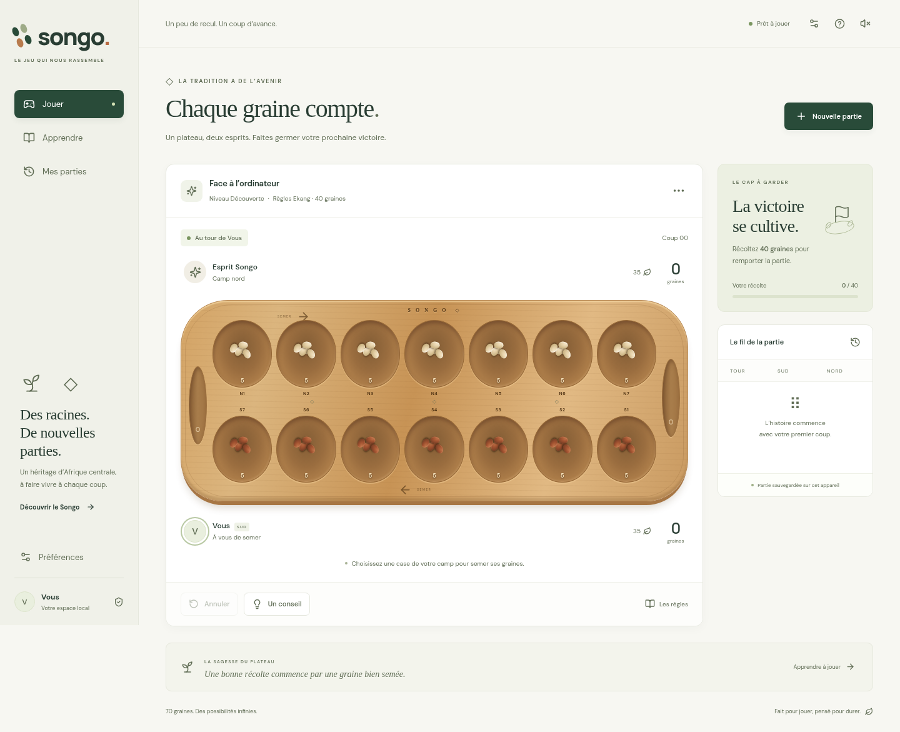

# Songo

Une nouvelle application du jeu de stratégie des peuples ekang. Interface française adaptée au mobile, plateau en bois, règles explicites et fonctionnement hors ligne après une première visite.



## Jouer

- **Solo** : trois difficultés, recherche minimax avec élagage alpha-bêta et approfondissement itératif. Calcul dans un Web Worker avec un budget maximal de 750 ms.
- **Duel local** : deux personnes sur le même appareil, avec leurs prénoms.
- Conseils, annulation, historique et relecture de chaque coup.
- Sauvegarde automatique, reprise après fermeture, export/import JSON validé par rejeu.
- Statistiques locales, son optionnel, repères et animations configurables.
- Application installable, polices et ressources hébergées avec le jeu, fonctionnement hors ligne via service worker.
- Navigation clavier, dialogues natifs, annonces de tour et prise en compte de la réduction des animations.

Les parties et statistiques restent dans le navigateur. Cette version ne propose pas de duel à distance, de compte ou de synchronisation serveur. Un nouveau plateau remplace le précédent ; exportez une partie pour l’archiver intégralement. Les 500 derniers résultats sont conservés.

## Développement

Node.js **24 LTS** et npm sont requis.

```bash
npm ci
npm run dev
```

```bash
npm test             # moteur, IA et validation des sauvegardes
npm run build        # vérification TypeScript et compilation de production
npm run preview      # servir la production localement
npm run test:e2e     # parcours desktop/mobile et audit axe
```

Les tests utilisent `/usr/bin/chromium` en développement sur cet environnement. Pour un autre poste, définissez `PLAYWRIGHT_CHROMIUM_EXECUTABLE_PATH`, ou installez le navigateur Playwright (`npx playwright install chromium`). En CI, Playwright utilise son propre Chromium.

Le service worker fonctionne sur HTTPS ou localhost et n’est activé que dans le build de production. Le serveur de développement ne constitue donc pas un test hors ligne. Une mise à jour du jeu est proposée dans l’interface, sans remplacer la partie en cours.

## Organisation

```text
src/
  game/          règles pures, IA et worker, configuration des niveaux
  components/    plateau, historique, nouvelle partie, résultats, règles, dialogues
  lib/           validation/persistance, export et audio
  App.tsx        orchestration des parcours et du cycle de vie de la partie
  styles.css     identité visuelle et mises en page adaptatives
public/          icônes et en-têtes de sécurité pour les hébergeurs compatibles
```

Le moteur ne dépend ni du DOM, ni de React, ni du stockage. `playMove` produit un nouvel état sans modifier l’entrée. La sauvegarde contient les coups, et non un état de plateau arbitraire. `replay` contrôle la légalité de toute la séquence à l’import et au chargement.

Voir [l’architecture et les limites](docs/architecture.md) et [la variante implémentée](docs/rules.md).

## Déploiement et montée en charge

`npm run build` produit **dist/**, déployable sur un CDN statique : Cloudflare Pages, Netlify, GitHub Pages ou tout serveur HTTP. Aucun secret ni serveur de calcul n’est nécessaire. Les chemins relatifs permettent également un hébergement sous `/songo/`.

Le workflow **Quality** exécute les tests et la compilation à chaque pull request. Le workflow **Publish to GitHub Pages** peut être lancé manuellement après activation de Pages avec la source « GitHub Actions ». Il publie le dossier `dist`.

Les ressources portent un hash ; servez-les avec un cache long. Servez `index.html` et `sw.js` avec revalidation. `public/_headers` fournit ces règles et des en-têtes de sécurité pour les hébergeurs qui comprennent ce format. Adaptez-les au serveur retenu.

La version de démonstration Sites est privée et sa configuration se trouve dans `.openai/hosting.json`. Les protections d’accès de l’hébergeur sont distinctes de la sauvegarde locale du jeu.

## Sources et crédits

Les règles suivent la variante Ekang publiée par le [Club Awalé](https://www.clubawale.com/post/comment-jouer-le-songo), avec un seuil à 40 graines. [Afrique Réveil](https://afriquereveil.com/jeux/songo/) rappelle la diversité des variantes. Les conventions numériques sont documentées séparément.

Interface et plateau réalisés en CSS/SVG. Icônes Lucide (ISC) ; polices DM Sans et Manrope distribuées par Fontsource (SIL Open Font License), intégrées au build.
